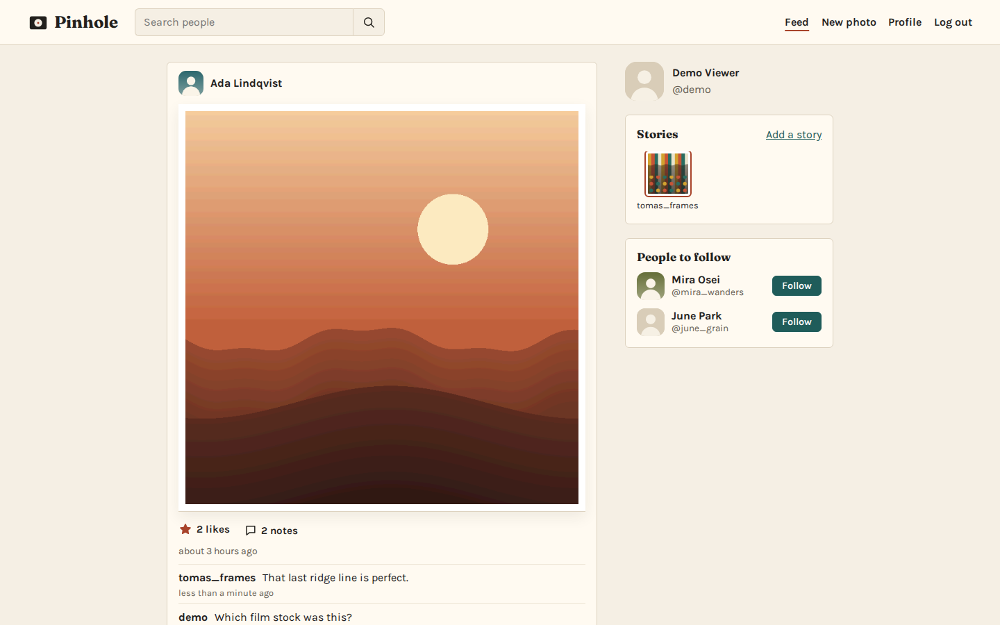
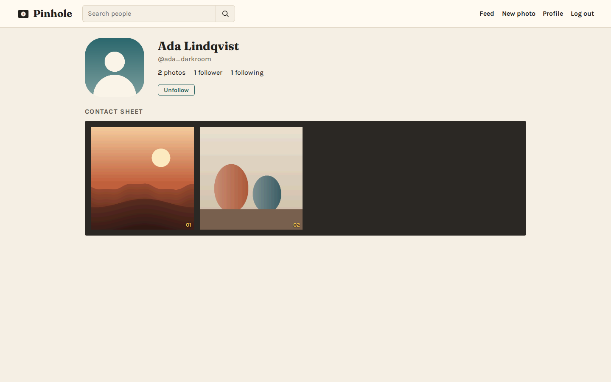
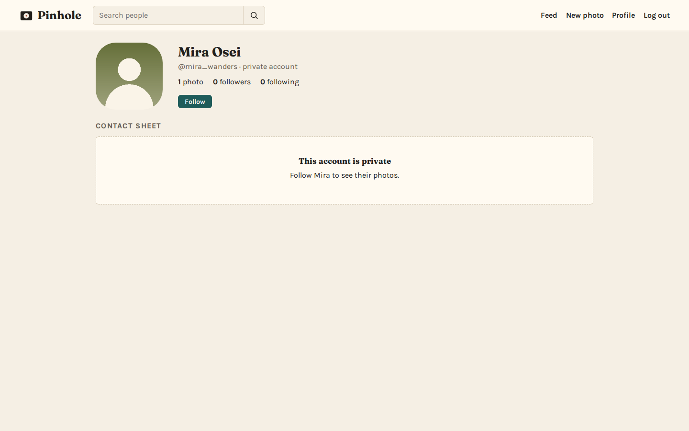
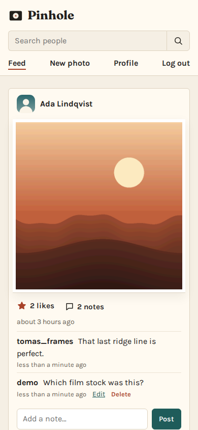
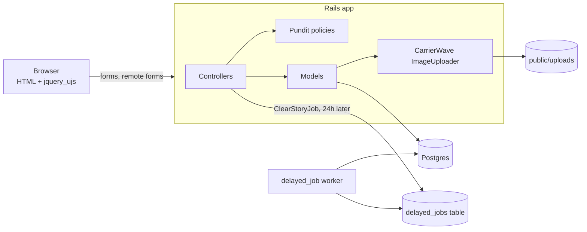

# Pinhole

Pinhole is a small photo-sharing web app built with Ruby on Rails. People post square photos, follow each other, like and leave notes on photos, share stories that fade after a day, and can make their profile private so that only followers see their photos.

It is a compact, readable example of a classic server-rendered Rails app: Devise for accounts, Pundit for authorization, CarrierWave for uploads, Active Job on delayed_job for background work, and a little jQuery for in-place likes and notes.



## Features

- **Accounts.** Sign up and log in (Devise). Password reset is wired up but needs SMTP, see Known limitations. Edit your name, username, email, profile picture and privacy setting.
- **Photos.** Upload PNG or JPEG files up to 10 MB. The owner can replace or delete a photo.
- **Feed.** Shows photos from you and the people you follow, newest first. Each photo shows its likes and notes, with a box to add a note.
- **Likes and notes.** Likes toggle in place. Notes can be added, edited by their author, and deleted by their author or by the photo's owner.
- **Stories.** A story appears at the top of your followers' feeds and is hidden by a background job after 24 hours.
- **Follow and search.** Follow and unfollow people, get up to five suggestions, and search by username or name.
- **Private profiles.** Photos from a private account, including direct links to them, can only be opened by the owner and their followers.

| Profile | Private profile | Mobile feed |
|---|---|---|
|  |  |  |

More screenshots are in [`docs/screenshots/`](docs/screenshots). They all come from the seeded demo data: fictional people and generated abstract images.

## Quick start (Docker Compose)

You need Docker with Compose v2.

```sh
cp .env.example .env
# Set DATABASE_PASSWORD and SECRET_KEY_BASE in .env (openssl rand -hex 64 makes a good key)
docker compose up --build
```

Open http://localhost:3000 and log in as `demo@pinhole.test` with the password `pinhole-demo`. The other demo accounts (`ada_darkroom`, `tomas_frames`, `mira_wanders`, `june_grain`) use the same password at `<username>@pinhole.test`. `mira_wanders` is private.

On first start, `web` creates the database, loads the schema and seeds the demo data. The `worker` service runs the background jobs. Uploaded files live in the `uploads` volume.

To stop the stack and delete its data:

```sh
docker compose down -v
```

### Tests and lint

```sh
docker compose run --rm --build test
```

This runs the Minitest suite (models, policies, jobs and request tests: 65 tests) and RuboCop against the Compose Postgres. Brakeman is also in the bundle: `bundle exec brakeman`.

### Without Docker

You need Ruby 3.4.12 (see `.ruby-version`) and PostgreSQL 13 or newer with the `pg_trgm` extension available.

```sh
bundle install
export DATABASE_HOST=localhost DATABASE_USERNAME=postgres DATABASE_PASSWORD=...
bin/rails db:prepare        # creates, loads the schema and seeds
bin/rails server            # http://localhost:3000
bin/rails jobs:work         # in a second terminal, to expire stories
bin/rails test && bundle exec rubocop
```

## Configuration

All settings come from environment variables. Compose reads them from `.env`.

| Variable | Purpose | Default |
|---|---|---|
| `DATABASE_HOST`, `DATABASE_PORT`, `DATABASE_USERNAME`, `DATABASE_PASSWORD` | Postgres connection | local socket |
| `DATABASE_NAME` | Database name (development/production) | `InstagramClone_<env>` |
| `SECRET_KEY_BASE` | Signs sessions and cookies in production | required |
| `RAILS_FORCE_SSL` | Redirect to HTTPS and mark cookies secure | `true` (Compose sets `false`) |
| `STORY_LIFETIME_MINUTES` | How long a story stays visible | `1440` |
| `PORT` | Host port in Compose | `3000` |

The repository has no `config/credentials.yml.enc` and needs no master key.

## How it fits together



- **Routes.** `/home` is the feed, `/profile/:username` a profile, `/posts/:id` a photo. Likes are `POST /posts/:id/like`, and notes are nested under posts.
- **Authorization.** `PostPolicy#show?` allows the owner, followers and anyone for a public account. Liking and commenting reuse that rule. Editing a post is owner-only. A note can be edited by its author and deleted by its author or the photo's owner. The author of a note is always the signed-in user, never a form field.
- **Uploads.** `ImageUploader` accepts only `jpg`, `jpeg` and `png`. It also checks the content type sniffed from the file bytes, because uploads are served from the app's own origin and an HTML or SVG file would be stored XSS.
- **Counts.** `likes_count` and `comments_count` are counter caches. Unique indexes on likes and follows stop a double click from storing duplicates. Foreign keys keep likes, notes and follows tied to real users and posts.
- **Stories.** Creating a story enqueues `ClearStoryJob` with `set(wait: Post.story_lifetime)`. The job only hides story-type posts and ignores ones that were deleted.
- **Front end.** Sprockets serves one plain CSS file and a short `application.js` (jQuery plus `jquery_ujs`). Likes and notes are remote forms whose `.js.erb` responses update one post in place.

## Known limitations

- Following is not approval-based. Anyone can follow a private account and then see its photos, so "private" means "hidden from people who do not follow you".
- Images are stored as uploaded, with no resizing and no EXIF stripping, on local disk (`public/uploads`). For more than one server, move CarrierWave to object storage.
- Password reset emails need an SMTP configuration, and none is set up.
- jQuery and `jquery_ujs` are kept from the original app. Moving to Turbo would be the natural next step on Rails 8.

## License

MIT, see [LICENSE](LICENSE).
